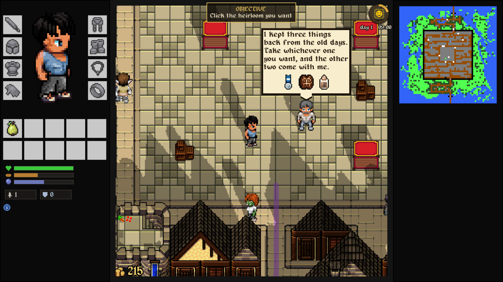

Software developer in Gothenburg, Sweden, with a Higher Vocational Diploma as a Java Developer from Teknikhögskolan (2023-2025). Open to junior developer roles.

- **Klarr Utvecklingsbyrå** (two internship periods): full-stack work on a Node.js, Next.js and MongoDB app run with Docker. Notification systems, S3 image upload endpoints, SES sign-up email, LLM-based quiz generation and schema design. Led the full-stack team of three.
- **Canguro Media** (part time): built an internal Python tool that produces finished video ads with ElevenLabs voice-over, stock footage and burnt-in captions. A set of six ads went from about 30 minutes to about 30 seconds. Shipped as a Windows and Mac app.

**Tech:** JavaScript, React, Next.js, Node.js, Java, Spring Boot, Python, MongoDB, SQL, AWS (S3, SES), Docker, GitHub Actions, JUnit, Claude Code

## Profit and Peril (private repo)

 

A 2D top-down medieval fantasy trading game in Python, which I have built solo since December 2024 using only Pygame and NumPy. The core is trading: every customer values an item by their race's preferences, its wear and origin, seven rolled personality traits and their memory of past deals with you, and then decides whether to queue, haggle or walk out. The game loop, layered renderer, A* pathfinding and delta-based save format are my own, with no game engine. I wrote all of the code myself for the first year before bringing in Claude Code.

The code is private, but I'm happy to walk through it in an interview.
