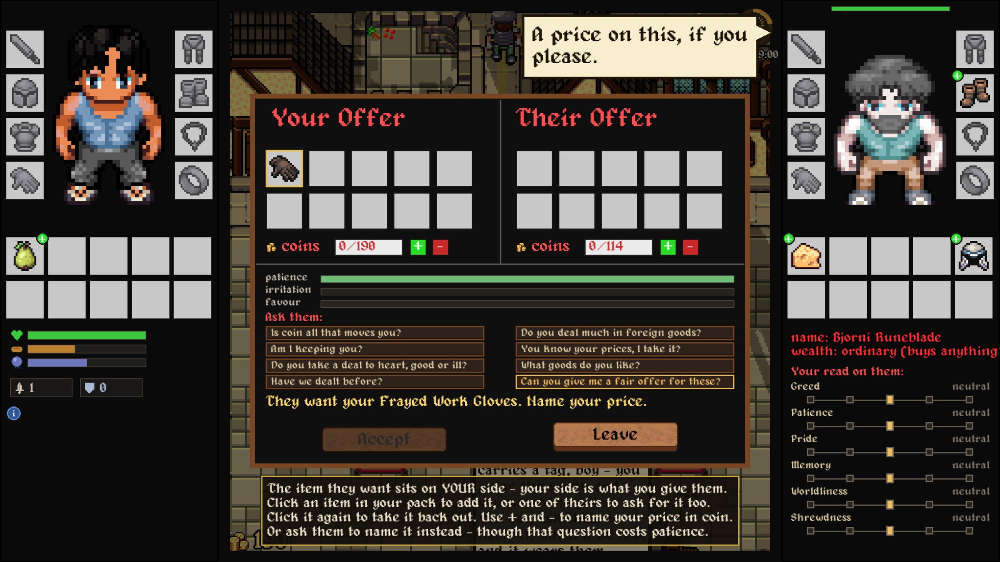

### Software developer in Gothenburg, Sweden, with a Higher Vocational Diploma as a Java Developer from Teknikhögskolan (2023-2025). Open to junior developer roles.

- **Klarr Utvecklingsbyrå** (two internship periods): full-stack work on a Node.js, Next.js and MongoDB app run with Docker. Notification systems, S3 image upload endpoints, SES sign-up email, LLM-based quiz generation and schema design. Led the full-stack team of three.
- **Canguro Media** (part time): built an internal Python tool that produces finished video ads with ElevenLabs voice-over, stock footage and burnt-in captions. A set of six ads went from about 30 minutes to about 30 seconds. Shipped as a Windows and Mac app.

**Tech:** JavaScript, React, Next.js, Node.js, Java, Spring Boot, Python, MongoDB, SQL, AWS (S3, SES), Docker, GitHub Actions, JUnit, Claude Code

## Profit and Peril (private repo)

 

A top-down medieval fantasy trading game in Python, built solo since December 2024 on Pygame and NumPy, with no game engine. I wrote all of the code myself for the first year before bringing in Claude Code.

**By day you trade.** You run a shop in a walled market town of humans, elves, dwarves and orcs. Customers walk in from their own daily routines, and each one values your goods differently: by their race's tastes, the item's wear and origin, their personality (greed, pride, patience, memory and more) and what they remember of past deals with you. You read them by asking questions and watching how they react, then haggle, and they buy, queue or walk out.

**By night you defend.** The town is raided after dark. Bandits come for your goods, monsters come for you, and the night only ends when the streets are clear. The coin you made during the day is what you defend with: archer towers on plots along the raiders' routes, and hiring, training and arming the town watch. The tower defense side is in active development.

**Under the hood:** my own game loop, layered renderer, A* pathfinding and delta-based save format, 125 townsfolk with daily routines, 117 items that wear down with use, and a day/night cycle where your character ages. 

### On shadows
As you can see in one of the images, I'm also experimenting a bit with dynamic shadows cast from 2d sprites depending on time of day, which is a bit tricky. So the shadows grow and shrink depending on time of day. Shadows cast straight upwards from strucutres and characters work quite well, but right now im also trying shadows that move diagonally from north-west to south-east on top of the shrinking and growing, in order to simulate a sun thats moving from south-east to south-west. for that i had to map all 2d sprites/structures with heightmaps, the height of each pixel, which is quite tedious but it was interesting to see a result that works quite well.its definitely harder to draw correct shadows in a 2d world than a 3d world. i might regress to purely straight shadwos in case the diagonal ones feel too agressive/take up to much attention. 

### The code is private, but I'm happy to walk through it in an interview.
